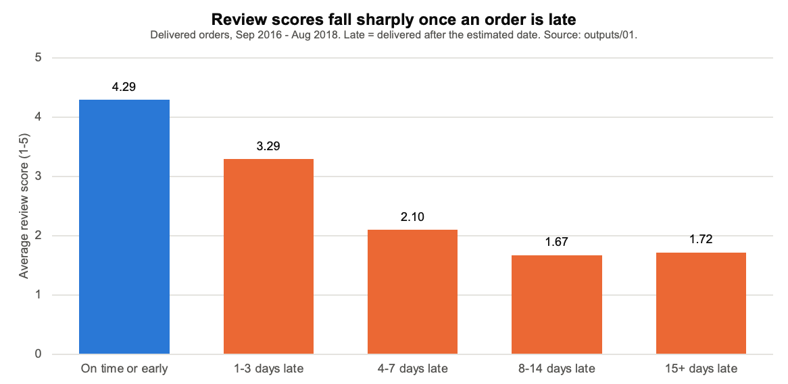

# E-commerce operations analysis: late deliveries and review scores

Author: Saathvik Maheshuni

For this project I looked at late deliveries on Olist, a Brazilian online marketplace. I wanted to find out where late deliveries happen, how much they hurt review scores, and what the operations team should fix first. I used SQL in SQLite on 96,470 delivered orders from September 2016 to August 2018. I also built a Tableau dashboard and wrote a one-page memo for an operations manager.

Tableau dashboard: [Late deliveries and review scores, Olist 2016-2018](https://public.tableau.com/app/profile/saathvik.maheshuni/viz/E-commerceoperationsanalysislatedeliveriesOlist/LatedeliveriesandreviewscoresOlist2016-2018)

## What I found

- 6.8% of delivered orders arrived after the estimated date. Late orders got an average review of 2.27 stars, while on-time orders got 4.29. 62.4% of late orders got a 1- or 2-star review. For on-time orders it was only 9.3%. Even 1 to 3 days late brings the average down to 3.29.
- Rio de Janeiro has a 12.1% late rate on 12,350 orders, so it makes up 22.9% of all late orders by itself. São Paulo has more late orders (27.9% of the total), but that is because it is so big. Its late rate is only 4.5% on 40,494 orders. The highest late rates are in smaller Northeast states like Alagoas (21.4%) and Maranhão (17.4%).
- Most of the delay happens after the seller ships. 72.2% of late orders reached the carrier on time. When a seller missed the shipping deadline (9.0% of orders), the order was late 20.8% of the time. If the seller shipped on time, that dropped to 5.4%.
- Late deliveries are not caused by a few bad sellers. The 31 sellers with at least 50 orders and at least double the average late rate make up only 8.6% of late seller-orders. An order with two sellers counts once for each seller.
- Late rates went up in November 2017, the busiest month (7,288 orders, 12.4% late), and again in February and March 2018 (14.1% and 19.0%).
- Shipping is expensive on small orders. On orders with less than 50 BRL of items, freight is 32.6% of what the customer pays. These orders are 29.8% of all orders. Across all orders, freight is 14.3%.
- Only 3.0% of customers ordered more than once. When the first order was late, 2.52% of customers came back. When it was on time, 3.04% did. This gap is based on only 160 repeat customers, and I did not test if it is significant.
- Office furniture has the lowest reviews of any category with 1,000 or more orders (3.64 stars on average, 21.9% low scores). Its late rate of 8.1% is about the same as baby products at 8.0%, but baby products average 4.1 stars. So I think the furniture problem has more to do with the products than with delivery.



## Data

I used the [Brazilian E-Commerce Public Dataset by Olist](https://www.kaggle.com/datasets/olistbr/brazilian-ecommerce) from Kaggle. Olist published it under the [CC BY-NC-SA 4.0](https://creativecommons.org/licenses/by-nc-sa/4.0/) license. In short, you have to give credit and you can't use it for commercial purposes. Anything you make from it also has to be shared under the same license. The raw files are not in this repo, and [data/README.md](data/README.md) explains how to download them. The tables in outputs/ are shared under the same license.

The dataset has 99,441 orders and 9 tables. I loaded 8 of them: orders, order items, payments, reviews, customers, sellers, products, and a table that translates category names into English. I did not use the ninth table, geolocation.

## How I did it

I loaded the CSV files into SQLite and wrote one numbered query in sql/ for each question. I only kept the 96,470 orders with the status "delivered" and a delivery date. I counted an order as late if it arrived on a later day than the estimated date shown to the customer. If an order had more than one review (547 orders did), I used the most recent one. Revenue means the item prices paid in BRL, without freight. That is the value of the products sold, which is different from the commission Olist earns.

Items and reviews can have several rows for one order, so joining them straight to orders would count some orders more than once. To avoid this, each query first rolls them up to one row per order (or per order and seller, or per order and category) before joining. sql/00_grain_checks.sql compares row counts and revenue totals before and after every join. All 13 checks pass, and sql/run_all.sql runs these checks first and stops if any of them fails. I made the charts in Excel from the saved results.

## Files

| Path | What it is |
|---|---|
| sql/00_data_profile.sql | Table sizes and orders with several reviews or several sellers |
| sql/00_grain_checks.sql | Checks that the joins don't add or lose rows |
| sql/01-08_*.sql | One query per question: review scores, states, sellers, categories, repeat customers, freight, monthly trend, seller handoff |
| sql/tableau_extract.sql | Summary table for the Tableau dashboard |
| outputs/*.csv | The saved result of each query, with the same file name |
| sql/load_data.sql | Loads the raw CSVs into data/olist.db |
| sql/run_all.sql | Runs every query and saves the results to outputs/, and stops if a grain check fails |
| outputs/charts.xlsx | The Excel charts, with the data behind each one copied from the CSVs |
| outputs/*.png | Pictures of those Excel charts |
| deliverables/operations_memo.pdf, .md | One-page memo with my recommendations |

## How to run it

Everything runs with the sqlite3 command-line tool (it's already on a Mac; on Windows you can get it from sqlite.org). From the project folder:

```bash
# download and unzip the Kaggle files into data/raw/ (see data/README.md)
sqlite3 data/olist.db < sql/load_data.sql
sqlite3 data/olist.db < sql/run_all.sql
```

The first command builds the database and the second saves every result to outputs/. The charts are in outputs/charts.xlsx. Their data is copied from the CSVs, so if you change a query, paste the new numbers into the matching sheet.

## Limitations

The data only covers 2016 to 2018, so it may not match the marketplace today. I don't know how Olist set its delivery estimates, so "late" depends on the estimate as much as on the carrier. Freight is the amount customers were charged, which isn't the same as what shipping really cost. There is also no profit data. 1,275 orders have more than one seller, and for those a late order counts against every seller in it. Orders that were still on the way when the data was pulled are left out, so the late rates for July and August 2018 are probably too low. A few delivered orders have dates in an impossible order (see outputs/00_data_profile.csv). I kept them, which changes the average-days columns slightly. Finally, late deliveries and low reviews go together, but this analysis does not prove that one causes the other.
